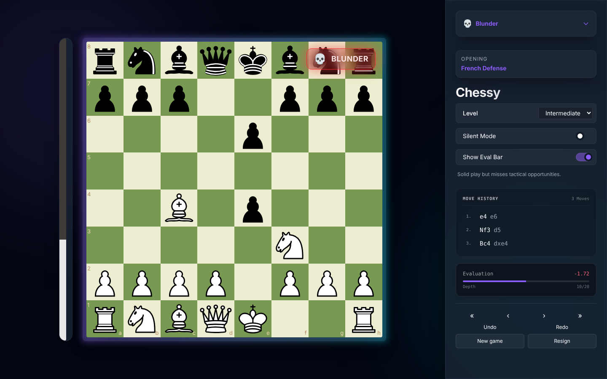
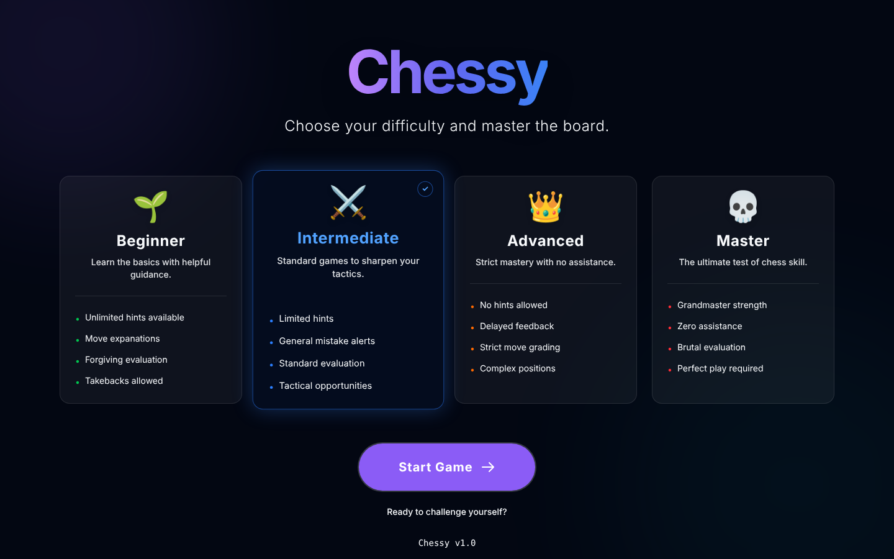
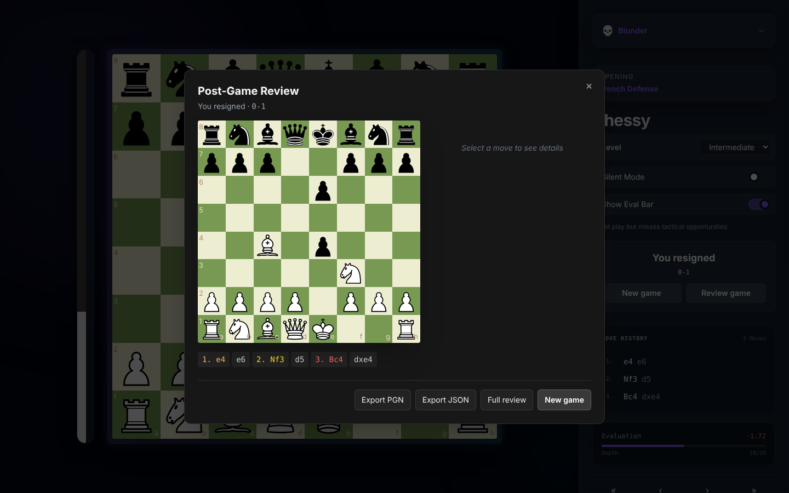
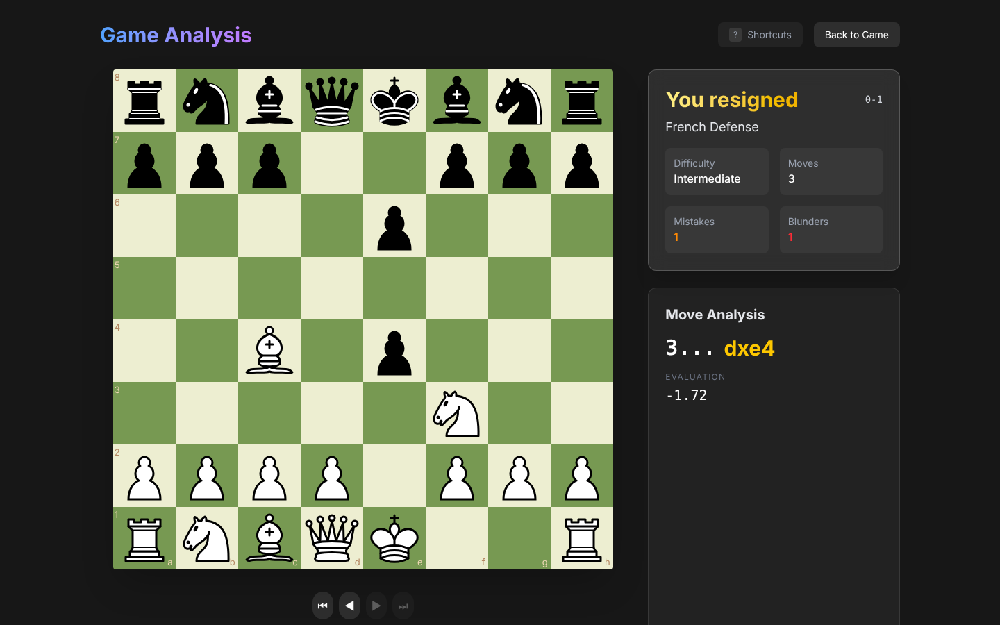

<div align="center">

# ♟️ Chessy

**Fast, minimalist chess training that tells you the truth, move by move.**

No accounts. No ads. No streaks. Just you, the board, and honest feedback.

[](./LICENSE)
[](./CONTRIBUTING.md)
[](https://github.com/youneedgreg/chessy/issues?q=is%3Aissue+is%3Aopen+label%3A%22good+first+issue%22)
[](https://github.com/youneedgreg/chessy/issues)
[](https://github.com/youneedgreg/chessy/stargazers)


[Getting started](#-getting-started) · [Features](#-features) · [Roadmap](#-roadmap) · [Contributing](#-contributing)



</div>

---

## Why Chessy?

I'm building Chessy out of my love for chess. Getting better at chess is hard, and most apps either tell you nothing while you play or bury you in gamification. Chessy sits in between: it plays against you at your level, grades **your** moves, explains what went wrong, and gets out of the way when you want to play seriously.

**Principles:**
- **Respect the player:** no hand-holding you didn't ask for, and no points, badges or streaks.
- **Teach by consequence:** show why a move fails, not just that it fails.
- **Zero friction:** no sign-up; open the page and play. Your game is saved in your browser.
- **Fast feedback:** the engine runs in your browser, in a Web Worker.

---

## ✨ Features

### Five training levels

| Level | Engine (per move) | Eval bar | Best-move arrow | Move feedback | Undo |
| --- | --- | --- | --- | --- | --- |
| 🌱 **Beginner** | depth 5, ≤ 1 s, weakened | ✅ | ✅ | Immediate grade + explanation | ✅ |
| ⚔️ **Intermediate** | depth 10, ≤ 1.5 s, weakened | Toggle | ❌ | Immediate grade, details on demand | ✅ |
| 👑 **Advanced** | depth 15, ≤ 2.5 s, weakened | ❌ | ❌ | Grade only, shown **after** the engine replies | ❌ |
| 💀 **Master** | full strength, ≤ 3 s | ❌ | ❌ | None during play | ❌ |
| 🤫 **Silent** | full strength, ≤ 3 s | ❌ | ❌ | None; review after the game | ❌ |

A **Silent Mode** toggle hides all feedback on any level.

### Playing
- Play as White or Black against Stockfish, compiled to WebAssembly and running in a Web Worker.
- Move grades (brilliant → blunder) for **your** moves, with opening detection.
- New game, resign, undo/redo (whole move pairs), and game-over detection (checkmate, stalemate, repetition, insufficient material, 50-move rule).
- Your game is saved in the browser, so a refresh doesn't lose it.

### Reviewing
- A post-game summary with move-by-move details.
- A full review page: replay, mistakes grouped by category, keyboard navigation.
- Export to **PGN** or **JSON**.

<table>
<tr>
<td></td>
<td></td>
<td></td>
</tr>
<tr>
<td align="center">Choose a level</td>
<td align="center">Post-game review</td>
<td align="center">Full analysis</td>
</tr>
</table>

> **Honest status:** Chessy is in active development. The game itself is solid, but the *teaching* layer (explanations, tactic detection, grading depth) still needs work. See [#107–#110](https://github.com/youneedgreg/chessy/issues/104) for details. That's a great place to contribute.

---

## 🚀 Getting started

**Requirements:** Node.js 20+ and npm.

```bash
git clone https://github.com/youneedgreg/chessy.git
cd chessy
npm install
npm run dev
# open http://localhost:3000
```

| Command | What it does |
| --- | --- |
| `npm run dev` | Start the dev server |
| `npm run build` / `npm start` | Production build / serve it |
| `npm run lint` | ESLint |
| `npm run type-check` | TypeScript check |

**Docker:** a `Dockerfile` and `docker-compose.yml` are included. The compose dev setup currently needs fixing ([#129](https://github.com/youneedgreg/chessy/issues/129)), so use `npm run dev` for now.

---

## 🧠 How it works

```
 you move ─► Zustand store ─► engine loop (useChessEngine)
                                  │
                                  ▼
                       Stockfish (Web Worker, WASM)
                       ├─ analyses the position (best move + eval, White's point of view)
                       └─ chooses its reply at the level's Skill Level
                                  │
                                  ▼
             grade your move ─► explanation ─► feedback (per level rules)
```

- **`src/engine`:** a Stockfish service that runs one search at a time, caps every search by depth **and** time, and normalises scores to White's point of view.
- **`src/hooks/useChessEngine.ts`:** the game loop. It analyses each position, grades the player's moves, and plays the engine's reply.
- **`src/logic`:** pure chess logic: grading, tactics, explanations, openings, PGN/JSON export.
- **`src/store`:** Zustand game state and level configuration, saved to `localStorage`.
- **`src/app`:** routes: `/` (levels), `/play`, `/review`.

**Stack:** Next.js 16 (App Router) · React 19 · TypeScript (strict) · Zustand · chess.js · react-chessboard · Stockfish 10 (WASM) · Tailwind CSS 4.

---

## 🗺️ Roadmap

Everything planned is tracked in **[#104](https://github.com/youneedgreg/chessy/issues/104)**, split into small, well-described issues. Highlights:

- 🤝 **Play a friend:** share a link, and the room's level sets the hints for both players ([#140](https://github.com/youneedgreg/chessy/issues/140)).
- 📖 **Guided openings on Beginner:** pick an opening, get it explained, and get guided move by move ([#106](https://github.com/youneedgreg/chessy/issues/106)).
- 🎯 **Better teaching:** accurate tactics, specific explanations, and deeper grading ([#107](https://github.com/youneedgreg/chessy/issues/107)–[#110](https://github.com/youneedgreg/chessy/issues/110)).
- 🎨 **Frontend revamp:** a design system, a mobile-first play screen, and a review page with an evaluation graph ([#133](https://github.com/youneedgreg/chessy/issues/133)–[#139](https://github.com/youneedgreg/chessy/issues/139)).
- ⚙️ **Stronger engine:** a modern multithreaded Stockfish build ([#132](https://github.com/youneedgreg/chessy/issues/132)).

---

## 🤝 Contributing

Contributions are very welcome, whether it's code, chess knowledge, design or docs.

1. Browse **[good first issues](https://github.com/youneedgreg/chessy/issues?q=is%3Aissue+is%3Aopen+label%3A%22good+first+issue%22)** or the roadmap in [#104](https://github.com/youneedgreg/chessy/issues/104).
2. Comment on the issue to claim it.
3. Read **[CONTRIBUTING.md](./CONTRIBUTING.md)** and open a PR.

**You don't need to be a strong chess player.** Many issues are pure frontend or tooling work. If you *are* a strong player, the opening content (#106) and the explanation rules (#107) need you.

Please follow the [Code of Conduct](./CODE_OF_CONDUCT.md). For security issues, see [SECURITY.md](./SECURITY.md).

### Contributors

<a href="https://github.com/youneedgreg/chessy/graphs/contributors">
  
</a>

Thanks to [@shafqat-baloch786](https://github.com/shafqat-baloch786) for the Docker support (#88).

---

## 📄 License

Chessy is released under the [MIT License](./LICENSE).

**Third-party:** the chess engine in `public/stockfish.js` / `public/stockfish.wasm` is [Stockfish](https://stockfishchess.org/), compiled to WebAssembly by [niklasf/stockfish.js](https://github.com/niklasf/stockfish.js). It is licensed separately under the **GNU GPL v3**; see [`public/stockfish.COPYING.txt`](./public/stockfish.COPYING.txt). The engine's source code is available from those projects.

## 🙏 Acknowledgments

- [Stockfish](https://stockfishchess.org/) and [stockfish.js](https://github.com/niklasf/stockfish.js) for the engine.
- [chess.js](https://github.com/jhlywa/chess.js) and [react-chessboard](https://github.com/Clariity/react-chessboard).
- [Lichess](https://lichess.org) for the inspiration on clean, fast chess UX.

<div align="center">

**Built for people who want to improve, not just play.** If Chessy helps you, a ⭐ helps others find it.

</div>
